# AI-Based District-Wise Cattle Breeding Resource Analysis Using Machine Learning, AIS and PSO

## Overview

This project presents an Artificial Intelligence-based framework for analyzing and forecasting district-wise cattle breeding resources using historical data from Artificial Insemination (AI) centres in Punjab, India.

The system integrates Machine Learning (ML), Deep Learning (DL), Artificial Immune System (AIS), and Particle Swarm Optimization (PSO) to analyze historical trends, predict animal counts, and evaluate different forecasting approaches.

The project aims to support data-driven livestock resource planning through predictive analytics, optimization techniques, and comparative model evaluation.

The framework includes:

- Random Forest Regression
- Artificial Neural Network (ANN)
- Artificial Immune System (AIS)
- Particle Swarm Optimization (PSO)
- Hyperparameter Optimization
- District-Wise Resource Forecasting
- Statistical Performance Evaluation
- Data Visualization

The AIS and PSO algorithms optimize Random Forest hyperparameters to investigate whether optimization improves forecasting performance over the baseline model.

---

## Project Objectives

The primary objectives of this project are:

1. Analyze historical cattle breeding resource data across districts.
2. Identify district-wise and year-wise changes in animal counts at artificial insemination centres.
3. Develop machine learning models for predicting animal counts.
4. Apply Artificial Immune System optimization to improve Random Forest hyperparameters.
5. Apply Particle Swarm Optimization for hyperparameter tuning.
6. Compare conventional machine learning, AIS, and PSO models.
7. Evaluate forecasting performance using regression metrics.
8. Generate district-wise predictions and visualizations.
9. Develop a reproducible framework for livestock resource analysis.

---

## Dataset Description

The project uses the following dataset:

**Dataset:** `Table_10.13_cowbulls_kept_AIcentres_0.csv`

The dataset contains historical records of cows and bulls maintained at Artificial Insemination centres.

### Dataset Information

| Attribute | Description |
|---|---|
| Dataset Name | Table_10.13_cowbulls_kept_AIcentres_0.csv |
| Domain | Agriculture and Animal Husbandry |
| Geographic Region | Punjab, India |
| Historical Period | 1968–2018 |
| Original Dataset Rows | 25 |
| Original Dataset Columns | 52 |
| Target Variable | Animal_Count |
| Prediction Type | Regression |
| Geographic Unit | District |
| Data Type | Historical numerical data |

### Dataset Features

The original dataset is converted from wide format into a district-wise time-series representation.

The model uses the following features:

| Feature | Description |
|---|---|
| Year | Historical observation year |
| District_Code | Numerical encoding of district |
| Lag_1 | Animal count in the previous year |
| Lag_2 | Animal count two years earlier |
| Lag_3 | Animal count three years earlier |
| Moving_Average_3 | Average of the previous three counts |
| Previous_Change | Difference between the previous two counts |
| Animal_Count | Target variable |

### Data Preprocessing

The following preprocessing operations are performed:

- Remove completely empty rows and columns.
- Remove invalid district entries.
- Exclude the Punjab aggregate row from district-level training.
- Convert year columns into numerical observations.
- Convert the dataset from wide to long format.
- Preserve valid zero-valued observations.
- Exclude missing target observations.
- Generate lag-based historical features.
- Use chronological training, validation, and testing splits.

Missing values are not automatically interpreted as zero.

Lag features are generated only when the required previous years are available.

---

## Project Architecture

The proposed system follows the architecture below:

```text
Historical Cattle Breeding Dataset
                |
                v
        Data Preprocessing
                |
                v
        Feature Engineering
                |
                v
    Chronological Data Splitting
                |
                v
    +-----------+-----------+
    |           |           |
    v           v           v
 Baseline      AIS         PSO
 ML Models   Optimization Optimization
    |           |           |
    v           v           v
 Random      Optimized    Optimized
 Forest      Random       Random
 / ANN       Forest       Forest
    |           |           |
    +-----------+-----------+
                |
                v
       Model Evaluation
                |
                v
       Performance Comparison
                |
                v
       District-Wise Forecasts
                |
                v
      Results and Visualization
```

---

## Algorithms Used

### 1. Random Forest Regression

Random Forest is an ensemble machine learning algorithm that combines multiple decision trees to generate predictions.

It is used as a baseline forecasting model.

**Advantages:**

- Handles nonlinear relationships.
- Supports multiple numerical features.
- Reduces variance through ensemble learning.
- Does not require feature scaling.
- Provides feature importance estimates.

The model predicts animal counts using historical observations and engineered features.

### 2. Artificial Neural Network

An Artificial Neural Network is implemented using TensorFlow and Keras.

The network consists of:

- Input layer
- Dense hidden layers
- ReLU activation functions
- Dropout regularization
- Linear output layer

The model uses the Adam optimizer and Mean Squared Error loss.

The neural network is saved in HDF5 format.

**Model File:**

`cattle_breeding_model.h5`

### 3. Artificial Immune System (AIS)

Artificial Immune System is a bio-inspired optimization technique based on mechanisms of the biological immune system.

This project implements a Clonal Selection Algorithm.

The optimization process includes:

1. Generate an initial antibody population.
2. Evaluate candidate hyperparameter configurations.
3. Select high-affinity antibodies.
4. Clone selected antibodies.
5. Apply hypermutation.
6. Retain strong candidate solutions.
7. Introduce random replacements.
8. Repeat until the maximum generation count is reached.

Each antibody represents a Random Forest hyperparameter configuration.

**Optimization Objective:**

Minimize validation Mean Absolute Error.

**AIS Parameters:**

| Parameter | Value |
|---|---|
| Population Size | 12 |
| Generations | 15 |
| Elite Antibodies | 4 |
| Clones per Elite | 5 |
| Random Replacements | 3 |
| Fitness Function | Validation MAE |

**Optimized Hyperparameters:**

- Number of estimators
- Maximum tree depth
- Minimum samples split
- Minimum samples leaf
- Maximum features

**Output Model:**

`ais_model.pkl`

### 4. Particle Swarm Optimization (PSO)

Particle Swarm Optimization is a population-based optimization technique inspired by the collective movement of birds and fish.

In this project, PSO searches for Random Forest hyperparameters that minimize forecasting error.

Each particle represents a candidate hyperparameter configuration.

The optimization process consists of:

1. Initialize particles and velocities.
2. Evaluate particle fitness.
3. Update personal best positions.
4. Update global best position.
5. Calculate new particle velocities.
6. Update particle positions.
7. Repeat optimization iterations.
8. Select the best hyperparameter configuration.

**PSO Velocity Equation:**

```text
v(t+1) = w*v(t)
       + c1*r1*(pbest - x(t))
       + c2*r2*(gbest - x(t))
```

**Position Update:**

```text
x(t+1) = x(t) + v(t+1)
```

Where:

- w = Inertia weight
- c1 = Cognitive coefficient
- c2 = Social coefficient
- r1, r2 = Random values
- pbest = Personal best position
- gbest = Global best position

**PSO Parameters:**

| Parameter | Value |
|---|---|
| Number of Particles | 12 |
| Maximum Iterations | 15 |
| Initial Inertia | 0.9 |
| Final Inertia | 0.4 |
| Cognitive Coefficient | 1.8 |
| Social Coefficient | 1.8 |
| Maximum Velocity | 0.2 |
| Fitness Function | Validation MAE |

**Output Model:**

`pso_model.pkl`

---

## Technologies Used

### Programming Language

- Python

### Libraries and Frameworks

- NumPy
- Pandas
- Scikit-learn
- TensorFlow
- Keras
- Matplotlib
- Seaborn
- Joblib
- PyYAML

### Development Environment

- Jupyter Notebook
- Visual Studio Code
- Python 3.x

### Machine Learning Techniques

- Supervised Regression
- Ensemble Learning
- Neural Networks
- Feature Engineering
- Hyperparameter Optimization
- Time-Series Forecasting

---

## Project Directory Structure

```text
AI-Based District-Wise Cattle Breeding Resource Analysis/
|
|-- Table_10.13_cowbulls_kept_AIcentres_0.csv
|
|-- README.md
|
|-- cattle_breeding_model.h5
|-- cattle_breeding_model.pkl
|-- preprocessing.pkl
|-- config.yaml
|-- metrics.json
|
|-- accuracy_graph.png
|-- heatmap.png
|-- comparison_graph.png
|-- comparison_results.csv
|-- result.csv
|-- result_graph.png
|-- prediction.csv
|-- prediction_graph.png
|
|-- ais_model.pkl
|-- ais_preprocessing.pkl
|-- ais_config.yaml
|-- ais_metrics.json
|-- ais_accuracy_graph.png
|-- ais_heatmap.png
|-- ais_comparison_graph.png
|-- ais_comparison_results.csv
|-- ais_result.csv
|-- ais_result_graph.png
|-- ais_prediction.csv
|-- ais_prediction_graph.png
|-- ais_convergence_graph.png
|-- ais_optimization_history.csv
|-- ais_district_performance.csv
|
|-- pso_model.pkl
|-- pso_preprocessing.pkl
|-- pso_config.yaml
|-- pso_metrics.json
|-- pso_accuracy_graph.png
|-- pso_heatmap.png
|-- pso_comparison_graph.png
|-- pso_comparison_results.csv
|-- pso_result.csv
|-- pso_result_graph.png
|-- pso_prediction.csv
|-- pso_prediction_graph.png
|-- pso_convergence_graph.png
|-- pso_optimization_history.csv
|-- pso_district_performance.csv
```

The structure represents files generated by the corresponding notebook scripts.

---

## Installation and Setup

### Step 1: Install Python

Install a compatible Python version from:

https://www.python.org/downloads/

### Step 2: Install Required Libraries

Run:

```bash
pip install numpy pandas scikit-learn tensorflow matplotlib seaborn joblib pyyaml jupyter
```

### Step 3: Open the Project Directory

Navigate to:

```text
C:\Users\sagni\Downloads\AI-Based District-Wise Cattle Breeding Resource Analysis
```

### Step 4: Start Jupyter Notebook

```bash
jupyter notebook
```

### Step 5: Execute the Models

Run the notebooks or code cells in the following order:

1. Baseline Machine Learning and Neural Network
2. Baseline Results and Visualizations
3. AIS Optimization
4. PSO Optimization

The AIS and PSO implementations can run independently using the original dataset.

---

## Model Training

The training process consists of three main stages.

### Stage 1: Baseline Machine Learning

The baseline system trains:

- Random Forest Regressor
- Artificial Neural Network

The trained models are evaluated using chronological data splits.

The model selection process uses validation Mean Absolute Error.

### Stage 2: AIS Optimization

The Artificial Immune System algorithm searches for Random Forest hyperparameters.

Each candidate solution is evaluated using validation MAE.

The best configuration is selected and used to train the AIS-optimized Random Forest.

### Stage 3: PSO Optimization

Particle Swarm Optimization searches the same hyperparameter space.

Particle positions and velocities are updated iteratively to minimize validation MAE.

The best particle determines the final Random Forest configuration.

---

## Model Evaluation Metrics

The project evaluates regression performance using the following metrics.

### Mean Absolute Error (MAE)

MAE calculates the average absolute difference between actual and predicted values.

```text
MAE = (1/n) * SUM(|Actual - Predicted|)
```

Lower MAE indicates better prediction performance.

### Root Mean Squared Error (RMSE)

RMSE measures the square root of the average squared prediction error.

```text
RMSE = SQRT(
    (1/n) * SUM((Actual - Predicted)^2)
)
```

Lower RMSE indicates smaller prediction errors.

### R-Squared Score (R²)

R² measures how well the predictions explain variation in the target variable.

```text
R2 = 1 - (
    SUM((Actual - Predicted)^2)
    /
    SUM((Actual - Mean_Actual)^2)
)
```

Higher R² generally indicates better model fit.

R² may be negative when the model performs worse than predicting the test-set mean.

**Important:** R² is not classification accuracy and should not be interpreted as an accuracy percentage.

---

## Results and Visualizations

The project generates graphical representations of model performance, feature correlations, predictions, and optimization convergence.

### 1. Baseline Accuracy / Performance Graph

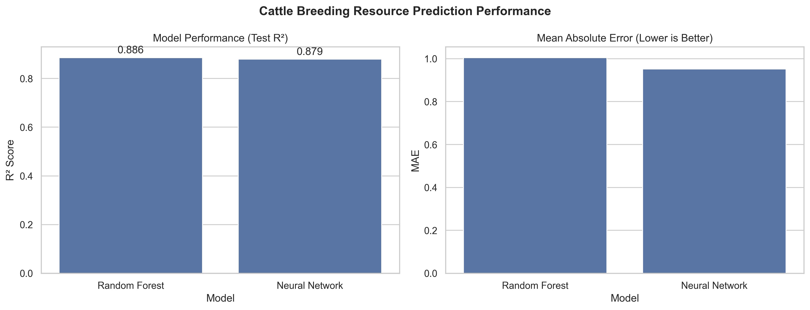

The graph compares the predictive performance of the baseline Random Forest and Artificial Neural Network.

It includes:

- R² score
- Mean Absolute Error

The visualization helps assess which baseline model provides better forecasting performance.

### 2. Feature Correlation Heatmap

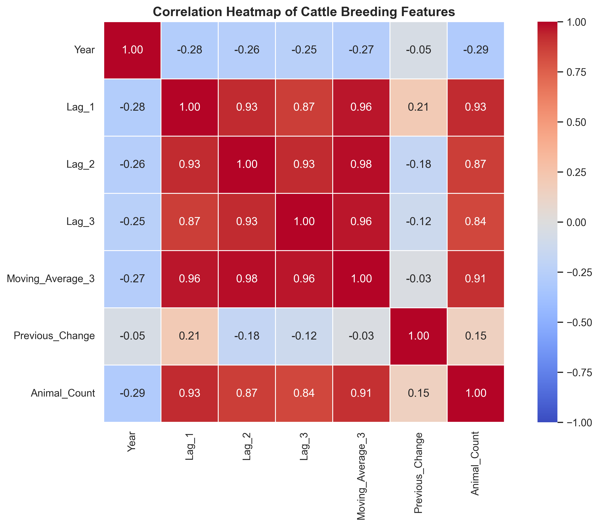

The correlation heatmap represents relationships among historical features and the target variable.

It includes:

- Historical year
- Lag features
- Moving averages
- Previous changes
- Animal counts

The heatmap supports exploratory analysis of relationships among numerical variables.

### 3. Baseline Model Comparison

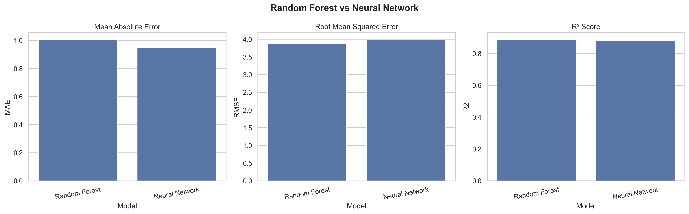

This graph compares the baseline models using:

- MAE
- RMSE
- R²

The comparison helps evaluate differences in predictive performance.

### 4. Baseline Prediction Results

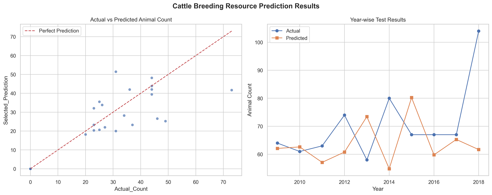

The result graph compares actual animal counts with model predictions.

It includes:

- Actual vs predicted scatter plot
- Year-wise actual and predicted values

The associated CSV file is:

`result.csv`

### 5. Baseline Future Predictions

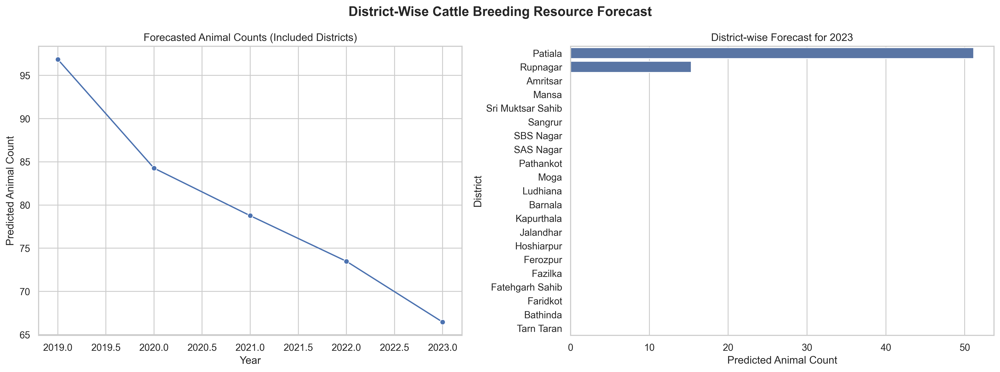

The prediction graph visualizes recursive forecasts for eligible districts.

The associated CSV file is:

`prediction.csv`

These are model-generated projections rather than verified observations.

---

## AIS Results and Visualizations

### AIS Performance Graph


Displays the test performance of the AIS-optimized Random Forest against the baseline.

### AIS Correlation Heatmap

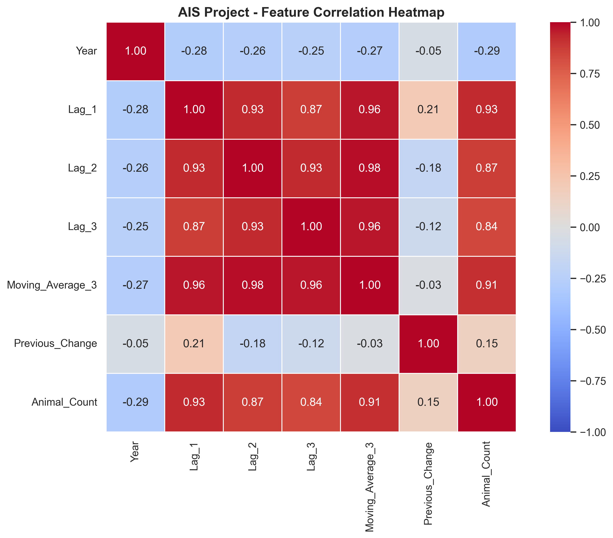

Displays correlations among historical numerical features.

### AIS Model Comparison

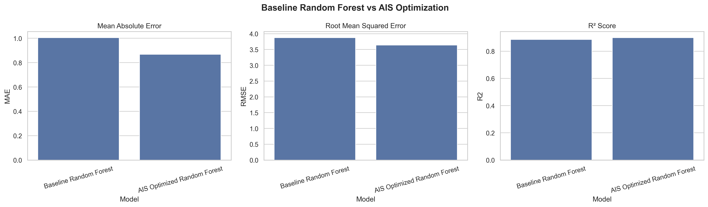

Compares baseline Random Forest and AIS-optimized Random Forest using regression metrics.

### AIS Prediction Results

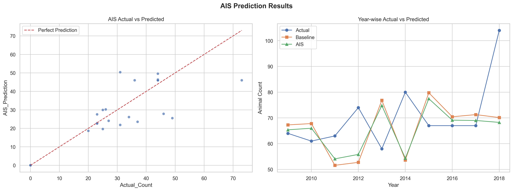

Visualizes actual animal counts and AIS model predictions.

### AIS Future Predictions

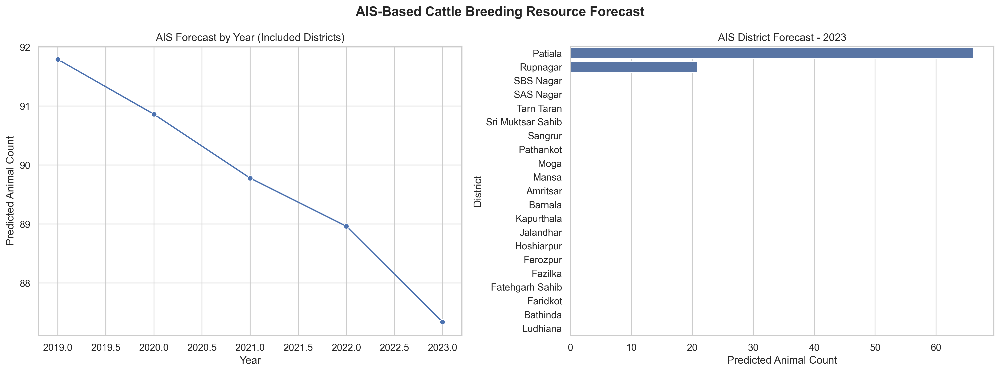

Displays district-wise recursive forecasts generated by the AIS-optimized model.

### AIS Optimization Convergence

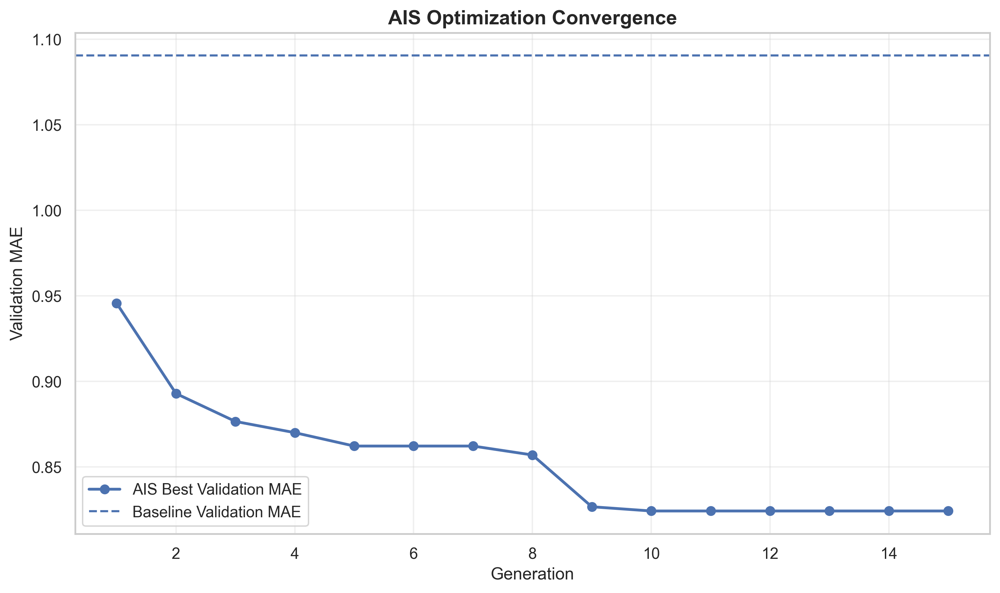

Shows how the best validation MAE changes across AIS generations.

A decreasing curve indicates that the optimization process has discovered configurations with lower validation error.

---

## PSO Results and Visualizations

### PSO Performance Graph

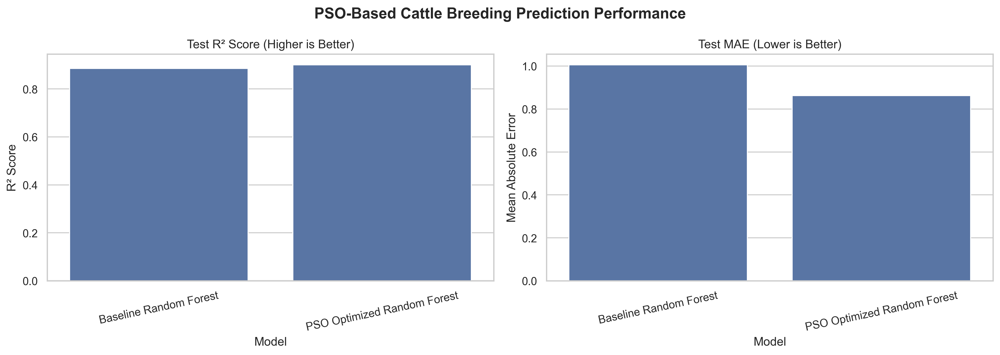

Compares the baseline Random Forest with the PSO-optimized model.

### PSO Correlation Heatmap


Displays correlations among the historical features.

### PSO Model Comparison

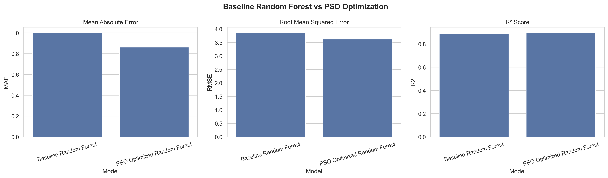

Compares baseline and PSO models using MAE, RMSE, and R².

### PSO Prediction Results

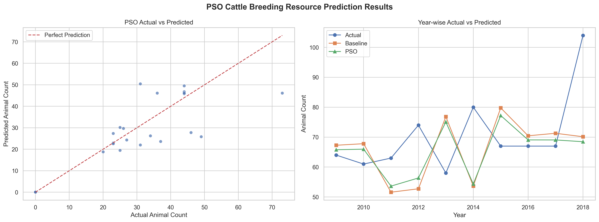

Displays actual animal counts and PSO model predictions.

### PSO Future Predictions


Visualizes district-wise forecasts produced by the PSO model.

### PSO Optimization Convergence

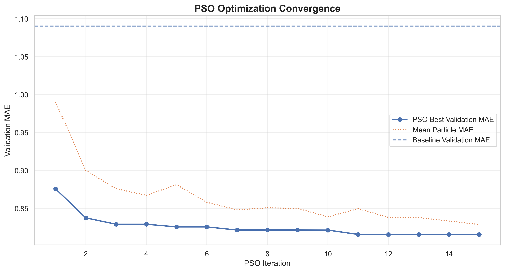

Shows changes in validation MAE during the PSO optimization process.

---

## Comparative Analysis

The project evaluates the following approaches:

| Model | Optimization Method | Evaluation Metrics |
|---|---|---|
| Random Forest | None | MAE, RMSE, R² |
| Artificial Neural Network | Gradient-based training | MAE, RMSE, R² |
| AIS Random Forest | Clonal Selection | MAE, RMSE, R² |
| PSO Random Forest | Particle Swarm Optimization | MAE, RMSE, R² |

### Comparative Evaluation Procedure

1. Train the baseline Random Forest.
2. Train the Artificial Neural Network.
3. Optimize Random Forest hyperparameters using AIS.
4. Optimize Random Forest hyperparameters using PSO.
5. Evaluate models on the same chronological test period.
6. Compare MAE, RMSE, and R².
7. Analyze optimization convergence.
8. Examine district-wise forecasting errors.

The best-performing approach should be determined from measured test results rather than assumed in advance.

### Research Hypothesis

The research investigates whether AIS and PSO hyperparameter optimization can improve Random Forest forecasting performance compared with a conventionally configured baseline.

The hypothesis must be validated using experimental results.

---

## District-Wise Resource Analysis

The system supports district-level analysis of historical animal counts maintained at artificial insemination centres.

Potential analytical outputs include:

- Historical animal count trends
- District-wise prediction errors
- Changes in resource availability
- Comparison of district-level forecasts
- Identification of districts with declining recorded counts
- Model-based estimates for resource planning

These analyses can support exploratory decision-making.

However, the dataset alone does not establish actual breeding demand, artificial insemination success rates, or the optimal number of AI centres.

Additional operational and demographic datasets would be required for those conclusions.

---

## Forecasting Methodology

The project uses lag-based recursive forecasting.

For each eligible district, the model uses:

- Previous year's animal count
- Animal count two years earlier
- Animal count three years earlier
- Three-year moving average
- Previous annual change
- District encoding
- Prediction year

The predicted value is used as a lag input for the next forecasting step.

### Forecast Period

The implemented scripts generate forecasts for:

**2019–2023**

Only districts with valid observations for 2016, 2017, and 2018 are included.

Forecasting limitations include:

- Error accumulation across future years
- Uncertainty from missing historical observations
- Changes in district boundaries or reporting practices
- Unobserved policy or infrastructure changes
- Limited generalization beyond the historical period

The forecasts should be treated as experimental estimates.

---

## Model Files

### Baseline Model

```text
cattle_breeding_model.pkl
```

Contains the trained baseline Random Forest.

### Neural Network Model

```text
cattle_breeding_model.h5
```

Contains the trained Keras neural network.

### AIS Model

```text
ais_model.pkl
```

Contains the AIS-optimized Random Forest.

### PSO Model

```text
pso_model.pkl
```

Contains the PSO-optimized Random Forest.

### Configuration Files

```text
config.yaml
ais_config.yaml
pso_config.yaml
```

Contain model configurations and experiment settings.

### Metrics Files

```text
metrics.json
ais_metrics.json
pso_metrics.json
```

Contain evaluation metrics and optimization results.

---

## Loading Trained Models

The trained Random Forest models can be loaded using Joblib.

```python
import joblib

baseline_model = joblib.load(
    "cattle_breeding_model.pkl"
)

ais_model = joblib.load(
    "ais_model.pkl"
)

pso_model = joblib.load(
    "pso_model.pkl"
)

print("All Random Forest models loaded.")
```

The neural network can be loaded using TensorFlow.

```python
import tensorflow as tf

nn_model = tf.keras.models.load_model(
    "cattle_breeding_model.h5",
    compile=False
)

print("Neural network loaded.")
```

Prediction inputs must use the same feature names, feature order, and district encoding as the corresponding training implementation.

---

## Research Contributions

The project provides an experimental framework combining machine learning and bio-inspired optimization for district-level cattle breeding resource forecasting.

The main contributions of the implementation are:

1. A district-wise historical data preprocessing pipeline.
2. Lag-based features for animal count forecasting.
3. Baseline Random Forest and neural-network models.
4. AIS-based Random Forest hyperparameter optimization.
5. PSO-based Random Forest hyperparameter optimization.
6. Chronological evaluation of forecasting models.
7. District-wise prediction and error analysis.
8. Optimization convergence visualizations.
9. Exportable models, configurations, metrics, and predictions.

These are implementation contributions. Scientific novelty and superiority over existing research require a separate literature review and experimental validation.

---

## Applications

Potential applications include:

### Livestock Resource Monitoring

Analyze changes in recorded cattle breeding resources over time.

### Agricultural Data Analytics

Apply predictive modeling to historical animal husbandry records.

### District-Level Forecasting

Estimate future animal counts using historical trends.

### Model Optimization Research

Compare AIS and PSO as hyperparameter optimization strategies.

### Decision Support

Provide analytical inputs for resource planning when combined with additional operational information.

### Academic Research

Support experiments in machine learning, time-series forecasting, and nature-inspired optimization.

---

## Limitations

The current implementation has several limitations:

1. The dataset covers historical records only through 2018.
2. Some district-year observations are missing.
3. Zero values may reflect genuine counts or reporting issues.
4. The dataset is relatively small.
5. District codes are numerical identifiers rather than geographic measurements.
6. Recursive predictions may accumulate forecasting errors.
7. Optimization may overfit the validation period.
8. A single chronological split may not fully establish model robustness.
9. No external breeding-demand or livestock-population dataset is integrated.
10. Model forecasts do not directly establish optimal AI centre allocation.

These limitations should be acknowledged when interpreting results or preparing a research paper.

---

## Future Scope

Potential future improvements include:

### 1. Hybrid AIS–PSO Optimization

Develop a hybrid optimization algorithm combining AIS-based diversity mechanisms with PSO-based global search.

### 2. Advanced Forecasting Models

Evaluate additional algorithms such as:

- XGBoost
- LightGBM
- Long Short-Term Memory (LSTM)
- Gated Recurrent Unit (GRU)
- Temporal Convolutional Networks

### 3. Rolling-Origin Validation

Use multiple chronological evaluation windows to assess generalization across different periods.

### 4. Explainable Artificial Intelligence

Integrate SHAP or permutation feature importance to interpret model predictions.

### 5. Geographic Visualization

Develop interactive district-wise maps using GIS data.

### 6. Additional Datasets

Integrate:

- Livestock census data
- Artificial insemination service records
- Breeding success statistics
- Veterinary infrastructure information
- District-level agricultural indicators

### 7. Web-Based Dashboard

Develop an interactive dashboard using Streamlit or Flask.

### 8. Resource Allocation Optimization

Extend the system to optimize actual AI centre allocation when reliable demand, cost, capacity, and geographic data become available.

---

## Reproducibility

The experiments use a fixed random seed:

```python
SEED = 42
```

The AIS and PSO implementations use:

- The same original dataset
- The same feature engineering procedure
- The same chronological splitting rules
- The same Random Forest baseline
- The same hyperparameter search bounds
- Validation MAE as the optimization objective
- The same test evaluation metrics

For stronger scientific conclusions, experiments should be repeated using multiple random seeds.

Statistical comparisons and rolling-origin validation are recommended before claiming significant improvements.

---

## Expected Outcomes

The project is designed to produce:

- Trained baseline machine learning models
- AIS-optimized Random Forest
- PSO-optimized Random Forest
- Model evaluation reports
- District-wise prediction results
- Historical feature correlation analysis
- Optimization convergence curves
- Comparative performance visualizations
- Recursive district-wise forecasts
- Reusable model and configuration files

Actual predictive performance depends on the dataset and experimental results.

---

## Conclusion

This project develops an AI-based framework for analyzing and forecasting district-wise cattle breeding resources using historical artificial insemination centre data.

Random Forest and Artificial Neural Network models provide baseline predictions, while Artificial Immune System and Particle Swarm Optimization algorithms are used to optimize Random Forest hyperparameters.

The framework supports comparative regression evaluation, district-wise analysis, forecasting, and graphical interpretation of model performance.

The experimental results can be used to investigate whether bio-inspired optimization improves forecasting accuracy and reliability.

The project demonstrates the application of machine learning and nature-inspired optimization to agricultural and livestock resource analytics.

---

## License

This project is intended for educational and academic research purposes.

Dataset usage and redistribution must follow the terms of the original data provider.

---

## Keywords

Artificial Intelligence, Machine Learning, Artificial Immune System, Particle Swarm Optimization, Random Forest, Deep Learning, Cattle Breeding, Artificial Insemination, Livestock Resource Analysis, District-Wise Forecasting, Agricultural Analytics, Hyperparameter Optimization, Time-Series Regression.
